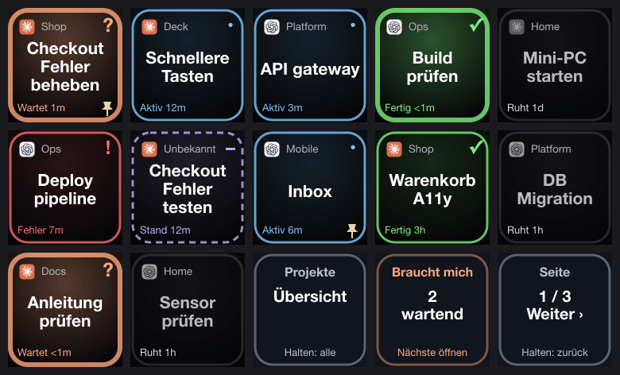
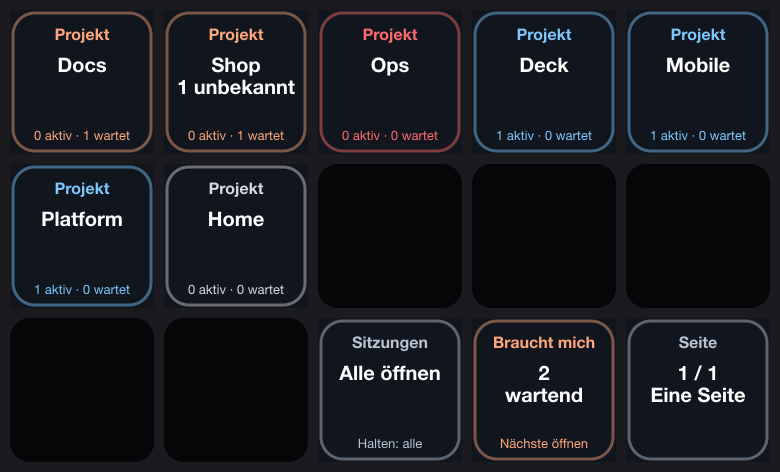

# AI Stream Decker

**Turn an Elgato Stream Deck into a live control center for your AI agents.**
Every Claude Code session and every ChatGPT/Codex thread gets its own key. The key shows what that agent is doing *right now*: thinking, waiting for your approval, finished, failed or idle. Open sessions with one press, group them by project, and pin the ones you keep coming back to. A dedicated **Braucht mich** key takes you through pending questions and approvals.



> Inspired by the OpenAI × Work Louder **Codex Micro** ("Your agents, in color"), a macro pad whose agent keys glow with real-time RGB status from Codex. It is sold out, and a Stream Deck has 15 tiny screens instead of RGB LEDs. So this project builds the same idea, with richer visuals, for hardware you may already own.

---

## Table of contents

- [What it shows](#what-it-shows)
- [Requirements](#requirements)
- [Install](#install)
- [Everyday use](#everyday-use)
- [How it works](#how-it-works)
  - [Architecture](#architecture)
  - [Claude Code](#claude-code)
  - [ChatGPT / Codex](#chatgpt--codex)
  - ["Seen" logic](#seen-logic)
  - [Key layout and paging](#key-layout-and-paging)
  - [Rendering pipeline](#rendering-pipeline)
- [Configuration](#configuration)
- [Prior art (why build this?)](#prior-art-why-build-this)
- [ChatGPT chat sessions (experimental)](#chatgpt-chat-sessions-experimental)
- [Limitations](#limitations)
- [Troubleshooting](#troubleshooting)
- [Project layout](#project-layout)

---

## What it shows

The palette follows the Codex Micro status colors, slightly saturated so they glow on the LCD keys:

| State | Look | Meaning | Codex Micro equivalent |
|---|---|---|---|
| **attention** | peach, pulsing border, `?` badge | The agent is blocked on you: permission prompt, `AskUserQuestion`, plan approval | "User approval required / question" |
| **working** | steady blue, `•` badge | The agent is thinking or running tools | "Thinking" |
| **done** | green, brief pulse during the first four seconds, then steady, `✓` badge | Finished, and you haven't looked at it yet | "Unread chat" |
| **error** | steady red, `!` badge | The turn ended on an API or stream error | "Error" |
| **idle** | dimmed, grayscale icon, no animation | Nothing happening (listed as a quick switcher; while anything needs you, they move to later pages) | "Inactive" |
| **unknown** | purple dashed border, `–` badge | The source is unreadable, has no known status, or stopped reporting activity | — |

Every key shows a small **app icon**, **project name**, up to **three title lines**, and a **status with elapsed time** at the bottom (`<1m`, `12m`, `3h`, `2d`). Long titles keep their ending so similar tasks remain distinguishable; identical visible labels receive `#1`, `#2`, etc. Pinned sessions have a small pin symbol. Unknown sessions show **Stand …**, the age of the last successful read (or last activity for stale working sessions), instead of pretending to be idle.

## Requirements

- macOS (tested on macOS 26 / Apple Silicon)
- Node.js ≥ 22.18 (uses the built-in `node:sqlite`; also required by the JPEG dependency)
- An Elgato Stream Deck with at least four LCD keys. Developed on a Stream Deck MK.2 / Original v2 (15 keys, 72×72 px). Key count and pixel size are read from the device; pedals and encoders are ignored.
- **The Elgato Stream Deck app must not be running.** This project talks to the device directly over USB HID, and only one program can own it.
- Claude Code (CLI and/or the Claude desktop app's Code tab) and/or the ChatGPT desktop app (bundle id `com.openai.codex`, which ships Codex)

## Install

```bash
git clone <this repo> AIStreamDecker && cd AIStreamDecker
npm install
node install.mjs
```

`install.mjs` is idempotent and does two things:

1. **Adds Claude Code hooks** to `~/.claude/settings.json`, creating it if needed. An existing file is backed up once to `settings.json.bak-aideck`; subsequent runs preserve that backup. Other hooks, including hooks in the same group, are left alone. Settings are replaced atomically.
2. **Installs a LaunchAgent** (`de.nfxmedia.aistreamdecker`) that starts the deck daemon at login and restarts it if it dies.

App icons are optional: if an app is absent or its icon cannot be extracted, its keys use a built-in text label.

Uninstall everything:

```bash
node install.mjs --uninstall
```

## Everyday use

- **Press a session key** to jump into it:
  - Claude desktop sessions open via `claude://code/continue?session=local_…`.
  - Claude CLI sessions target their **iTerm pane or Terminal tab** when the hook captured its identity. Other terminals fall back to opening the app and briefly show **Nur App geöffnet** on the key.
  - Codex threads open via `codex://threads/<id>`.
- **Hold a session key for 0.7 s** to pin or unpin it. Pins are saved separately in the all-sessions view and each project. An ended pinned session keeps its key as **Nicht aktiv** until you unpin it.
- **Projekte** opens the project overview. Each project shows how many sessions are active or waiting, plus an unknown-status count when needed. Press a project to see its sessions; press **Projekte** again to go back. Hold the navigation key to return directly to all sessions.
- **Braucht mich** shows the number of waiting sessions across all projects. Each press opens the next one, starting with the oldest request. Resolved requests leave the queue automatically. This opens the session; it does not answer questions or approve actions.
- **Seite** (bottom right, e.g. `2 / 4`) moves to the next page. Hold it to go back. Pages stay where you left them by default; an automatic return to page 1 is optional.

The last three keys always contain project navigation, **Braucht mich**, and the pager. On a 15-key deck this leaves **12 session keys per page**. A short press takes effect on release; a long press performs only the hold action.



- Watch what the deck is showing:

  ```bash
  tail -f ~/.ai-deck/deck.log
  ```
- Regression checks: `npm test` (hooks, source failures and recovery, rollout parsing, rendering, installation, terminal targets, and a simulated Stream Deck including projects, pins, paging and the waiting queue; uses a temporary home without modifying your services).
- Optional Swift bridge path check: `swift gpt-ax/main.swift --self-test`.
- Re-render the README preview after design changes: `node preview.mjs`

## How it works

### Architecture

```
 Claude Code (CLI + desktop) ──hooks──▶ hook.mjs ──▶ ~/.ai-deck/claude/<session>.json ─┐
 Claude desktop session store ─────────▶ …/Claude/claude-code-sessions/**/local_*.json ─┤ title, deep-link id, lastFocusedAt
 ChatGPT app / Codex ──────────────────▶ ~/.codex/state_5.sqlite  (threads)             ├──▶ deck.mjs ──USB HID──▶ Stream Deck
                                        ~/.codex/sessions/**/rollout-*.jsonl (events) ─┘        │   ▲
                                                                                                │   └── key press
                                                                     render.mjs (SVG → sharp → RGB) ◀┘
                                                                     open claude://… / codex://…
```

Everything is local. Nothing is sent anywhere, and no credentials or API tokens are touched.

### Claude Code

Claude Code hooks are the most precise signal available. `hook.mjs` is registered for these events and turns them into one small status file per session (`~/.ai-deck/claude/<session_id>.json`):

| Hook event | Resulting state |
|---|---|
| `UserPromptSubmit`, `PostToolUse` | working |
| `PreToolUse` | working, or **attention** for `AskUserQuestion` / `ExitPlanMode` (tools that block on you) |
| `PermissionRequest` | **attention** |
| `Notification` | **attention**, except the 60 s "still idle" ping after a finished turn, which must not re-flag a session you already saw |
| `Stop` | **done** |
| `StopFailure` | **error** |
| `SessionStart` / `SessionEnd` | registers / removes the session |

The state logic lives in the hook, not in the daemon, so the daemon can restart at any time without losing state. Status files are replaced atomically with owner-only permissions. `test.mjs` exercises the transitions and rejects malformed input.

**CLI tab targeting.** The hook records `ITERM_SESSION_ID` for iTerm and the parent process's terminal device for Apple Terminal. iTerm opens its existing pane through the native [`iterm2:reveal` URL](https://iterm2.com/documentation-url-scheme.html). Terminal uses AppleScript to find the matching `tty`, select its tab and bring its window forward. macOS may ask for Automation permission the first time. Older sessions acquire the metadata on a subsequent hook event; starting a new session also refreshes it. If exact targeting is unavailable or the command fails, the key shows a fallback notice and the session is not marked seen merely because its terminal app opened.

**Desktop mapping.** The Claude desktop app keeps one JSON file per Code-tab session. It contains `cliSessionId` (the id hooks see), `sessionId` (`local_…`, used by the deep link), `title`, `isArchived` and `lastFocusedAt`. The daemon joins both, so desktop sessions show their real title and open in the right tab. Desktop sessions without any hook activity yet are listed as idle.

### ChatGPT / Codex

The ChatGPT desktop app stores every Codex thread in `~/.codex/state_5.sqlite` (`threads` table: title, `rollout_path`, `archived`, `updated_at_ms`). Each thread also has an append-only *rollout* JSONL file. On first use, the daemon scans backwards in 512 KB chunks to the most recent lifecycle event. Later reads cover appended records, retain the previous status across tool output, and retry incomplete records. The cache detects truncation, replacement and same-size rewrites using file size, modification time and inode:

| Rollout event | State |
|---|---|
| `task_started` | working |
| `task_complete`, `turn_aborted` | done |
| `error`, `stream_error` | error |
| `exec_approval_request`, `apply_patch_approval_request`, `request_user_input` | attention |

Sub-agent threads (`source` is a JSON object) are hidden. Archived threads disappear. "Work" and voice threads from the app are included.

Read errors retain previously known sessions as **unknown**, including during database migrations or temporarily unavailable rollout files. The next successful refresh restores their status. Without a cached thread list, an unreadable Codex source gets its own diagnostic key. A successful read that contains no recognized lifecycle event also yields unknown. Claude hook read failures retain known sessions in the same way; a normal `SessionEnd` removes them.

### "Seen" logic

A finished session stays green until you have looked at it:

- pressing its key marks it seen after the session-specific open command succeeds (persisted atomically in `~/.ai-deck/seen.json`); merely activating a terminal app does not count;
- for Claude desktop sessions, opening the session in the app counts (`lastFocusedAt`), and so does a session that finishes *while it is on screen* (Claude is the frontmost app and the session is the most recently focused one);
- anything that finished more than 12 h ago is treated as seen, so old history never lights up.

### Key layout and paging

Keys are ordered by what needs you, so page 1 never fills up with irrelevant sessions:

1. **Needs a click:** waiting for you (attention), then errors, then finished-but-unread (done).
2. **Running:** working sessions.
3. **Quiet:** idle and unknown sessions. When anything from tiers 1–2 is on the deck, quiet sessions start on the **next page**; if nothing needs you, they fill page 1 as usual.

A session that changes tier moves right away (e.g. a finished session jumps to the front). Within a tier, sessions keep their previous order, so keys don't shuffle on every refresh. Project views are ordered the same way and keep their own layouts. A press targets the key that was displayed when the press began, even if a refresh happens while it is held.

Pins reserve their positions across restarts and even while a session is inactive. Unpinned sessions are continuously ordered by the tiers above. Projects are grouped by their normalized working directory (`cwd`); sessions without one appear under **Allgemein**. Projects with the same folder name include their parent folder in the label. The global waiting queue remains accessible from every view.

### Rendering pipeline

`render.mjs` builds one SVG per key (radial status glow, animated border, app icon, title, badge) and rasterizes it with [sharp](https://sharp.pixelplumbing.com/) into the raw RGB buffer the device expects. The JPEG encoding for the device happens inside `@elgato-stream-deck/node` (libjpeg-turbo).

Only attention keeps pulsing; done pulses briefly and all other states stay still. Animation is **quantized into a fixed number of phases**. Identical frames produce identical SVG strings, which hit an in-memory raster cache, and a key is only re-sent to the device when its SVG actually changed. The cache retains at most 1,024 frames and evicts the oldest entry individually. Time labels use minute granularity; drawing is scheduled at roughly 12 fps.

## Configuration

Pins and page behavior live in `~/.ai-deck/preferences.json`, saved automatically when you pin a session. Changes are picked up on the next refresh. `pageResetSeconds` defaults to **0** (disabled). To return to page 1 after 20 seconds, set it to `20`; leave the existing `pins` array intact. If the file does not exist yet, you can create it with:

```json
{ "pageResetSeconds": 20, "pins": [] }
```

Other tunables are constants at the top of [`deck.mjs`](deck.mjs):

| Constant | Default | Meaning |
|---|---|---|
| `WINDOW` | 3 days | sessions without activity for this long are hidden |
| `DONE_FRESH` | 12 h | a finished session stays highlighted this long unless you look at it |
| `STALE_WORK` | 30 min | "working" without any sign of life for this long is shown as unknown |
| `HOLD` | 700 ms | hold duration for pinning, backward paging and returning to all sessions |
| `BRIGHTNESS` | 70 | panel brightness in percent |

Colors and animation timings live in [`render.mjs`](render.mjs) (`COLOR`, `stateLayer`).

## Prior art (why build this?)

As of October 2026:

- **Codex Micro** (OpenAI × Work Louder) is dedicated hardware with RGB agent keys, approve/deny keys, a reasoning knob and a joystick. It covers Codex only and is sold out.
- **Stream Deck plugins for Claude Code** (e.g. *stream-deck-claude-code*, *agent-vitals*, *claudeck*, *agentsd*) are Elgato SDK plugins. They require the Elgato app and only cover Claude Code.
- There is reportedly an official Elgato marketplace plugin for **ChatGPT & Codex**, again tied to the Elgato app and to OpenAI only.

None of them shows **Claude Code and Codex side by side**, and none deep-links into the *exact* desktop session. Driving the device directly over HID also removes the dependency on the Elgato app and its plugin packaging.

## ChatGPT chat sessions (experimental)

Plain ChatGPT conversations (not Codex threads) are **not shown yet**. Unlike Codex, they live on the server: the app keeps no live local record of them. The only local cache (`codex.chatgpt-conversations` in the app's LocalStorage) is a stale list snapshot.

The remaining local signal is the app's UI itself. [`gpt-ax/`](gpt-ax) contains a small Swift bridge (`AIStreamDeckerGPT.app`) that reads the ChatGPT window via the macOS Accessibility API. It dumps the tree to `~/.ai-deck/gpt-ax.json` and can press elements on request. This directory is restricted to the current user because the tree can contain conversation text. Element paths are validated before use. All interpretation is meant to happen in JS, so routine interpretation changes do not require a binary rebuild. It is installed only with `node install.mjs --gpt` and needs **Accessibility permission**.

Status: on the development machine, macOS (26) has not yet applied the grant to the bridge reliably. The details are in the troubleshooting section below. Once it reads the tree, the plan is to parse the sidebar's chat list and streaming indicators into the same state model.

## Limitations

- Ordinary Claude chats (outside the Code tab) have no status interface and are not shown.
- Codex approval prompts appear as attention only if Codex writes the request into the rollout. Otherwise the thread stays "working".
- For Codex, "seen" only works by key press, because the app does not record which thread you are looking at.
- Sessions that ran before installation appear after their next hook event (desktop sessions appear immediately as idle).
- A "working" session without new activity turns unknown after `STALE_WORK`. There is no process liveness check; a long silent task can also trigger this state.
- Exact CLI targeting currently supports Apple Terminal and iTerm. Other terminals open at app level. An accepted app URL does not provide confirmation that the destination session still exists.
- Project grouping uses the session's exact working directory; separate subdirectories and worktrees appear as separate projects.

## Troubleshooting

| Symptom | Fix |
|---|---|
| Deck stays dark | Quit the Elgato Stream Deck app, then `launchctl kickstart -k gui/$(id -u)/de.nfxmedia.aistreamdecker` |
| A Claude session never changes state | It was started before the hooks were installed. Send it one more prompt, or restart it. |
| `deck.log` shows `codex read failed` | Check whether the Codex database is being migrated or is unavailable. Known sessions remain visible as unknown and recover after a successful refresh. |
| A terminal key shows `Nur App geöffnet` | Start a new Claude CLI session to capture its terminal identity. For Apple Terminal, allow Automation access when macOS asks. Other terminal apps currently use app-level fallback. |
| A pinned key says `Nicht aktiv` | The session ended or left the activity window. Hold the key to free its reserved position. |
| GPT bridge reports `"trusted": false` | Remove every `AIStreamDeckerGPT` / `gpt-ax` entry under *System Settings → Privacy & Security → Accessibility*, run `tccutil reset Accessibility de.nfxmedia.aistreamdecker.gpt`, then add `gpt-ax/AIStreamDeckerGPT.app` again. `build.sh` signs with your *Apple Development* identity when one exists, so the grant survives rebuilds. |

## Project layout

| File | Purpose |
|---|---|
| [`deck.mjs`](deck.mjs) | daemon: data sources, ranking, priority slots, paging, device I/O, key presses |
| [`model.mjs`](model.mjs) | project grouping, priority slots, validated preferences and waiting queue |
| [`render.mjs`](render.mjs) | key artwork (SVG), animation phases, raster cache |
| [`hook.mjs`](hook.mjs) | Claude Code hook → per-session status file |
| [`install.mjs`](install.mjs) | installs/uninstalls hooks and LaunchAgents |
| [`test.mjs`](test.mjs) | isolated regression checks for sources, rendering, installation, terminals and deck interactions |
| [`preview.mjs`](preview.mjs) | renders the session deck animation and project overview in `docs/` |
| [`gpt-ax/`](gpt-ax) | experimental Accessibility bridge for ChatGPT chats |
| `assets/` | app icons, extracted from the installed apps by `install.mjs` (not committed: vendor trademarks) |
